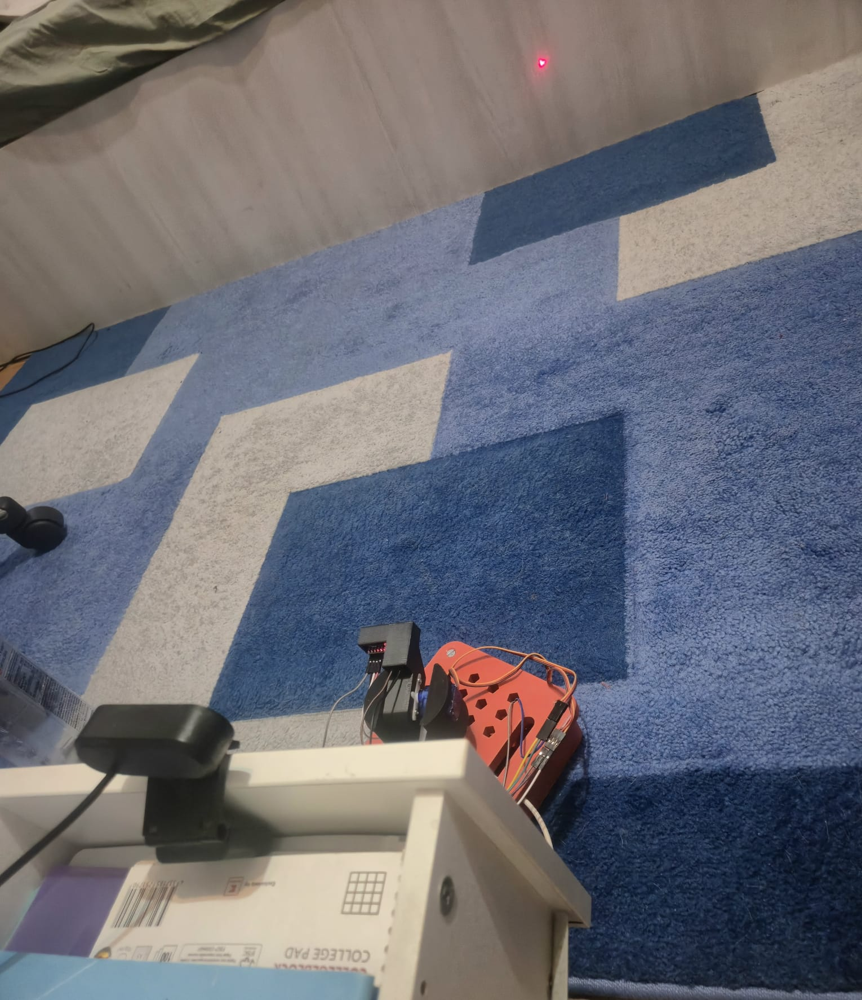
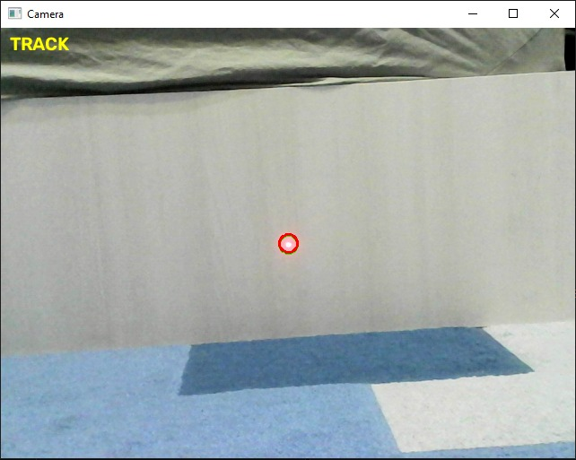
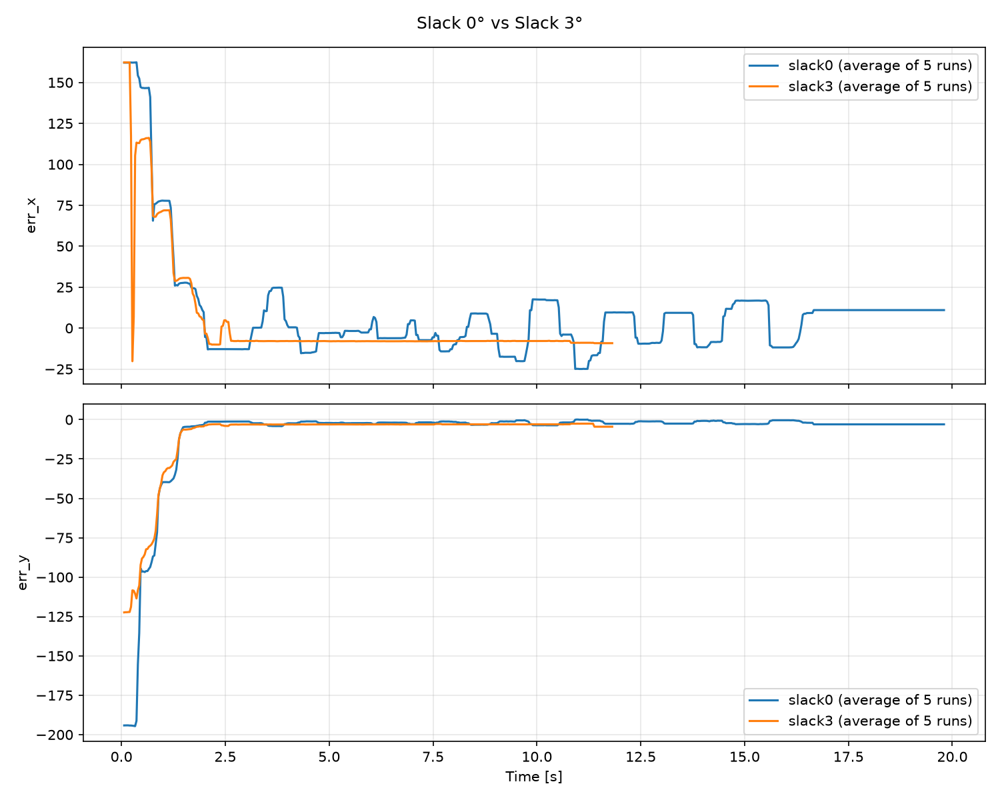

# Optomechanical Laser Alignment Testbench

Testbench built to evaluate how well camera feedback and mechanical spring preloading can compensate for backlash and vibration in cheap SG90 micro-servos when steering a laser beam.

An ESP32 controls a 2-axis pan-tilt mount carrying a KY-008 650 nm laser module, while reading an MPU-6050 IMU. A webcam connected to the PC tracks the laser spot and measures its offset from the center of the camera image. The PC sends pan/tilt corrections to the ESP32 over UART to bring the laser spot back to the center. The OpenCV tracker also supports manual target selection and color-based tracking.

## Hardware notes

The pan-tilt bracket is 3D-printed and uses springs to preload the servo gears. SG90 servos draw current spikes that can brown out the ESP32, so the rig is powered over a USB 3.0 port, and the software limits the current draw by moving one axis at a time with ramped steps. A 100 nF ceramic capacitor on the 5V rail filters noise. The laser module (KY-008, rated for 5V) is powered from the 3.3V rail, so its output is dimmer than at full voltage. It is switched through an NPN transistor driven from GPIO 27.

Sensor on the rig:
- MPU-6050 IMU on the laser bracket to measure vibrations and impacts.

## Physical Setup

<p align="center">
  
</p>

Current bench setup with the 3D-printed pan-tilt mount, SG90 servos, KY-008 laser module, and the MPU-6050 mounted directly on the top tilt bracket. The ESP32 sits on the breadboard with the 100 nF decoupling capacitor on the 5V rail. The laser is driven directly from GPIO 27 through a 1k series resistor with a 10k pull-down.


## I2C Address

3.3V logic

| Component | Bus / Pins | Address | Notes |
| :--- | :--- | :--- | :--- |
| MPU-6050 | I2C0 (GPIO 21 / 22) | 0x68 | IMU on laser bracket (clone chip, WHO_AM_I = 0x72) |

Other pins (servo PWM, laser transistor, SPI) are listed in docs/wiring.md.

## Camera-Centering & IMU Validation Test

MPU-6050 at 100 Hz (sample rate divider 9, DLPF 44 Hz), ±2 g and ±250 deg/s. The IMU is mounted directly on the moving tilt bracket next to the laser. The test starts with the laser spot away from the center of the camera image. The PC detects the spot, calculates the horizontal and vertical error in pixels, and continuously sends servo corrections over UART.


<p align="center">
  
  
</p>

Final alignment result, with the laser spot positioned close to the center of the camera image after the pan-tilt correction loop converges.

 - 0.0 - 0.2 s: Initial position, with the laser spot offset from the camera center (approximately +52 px on X and -165 px on Y). The servos start at around pan 105° and tilt 95°.
 - 0.2 - 1.0 s: The first corrections begin. Both servo angles decrease in steps, moving the laser closer to the center. The Y error starts dropping significantly, while the IMU records the initial movement and mechanical vibrations.
 - 1.0 - 1.8 s: The controller makes further corrections. Pan briefly moves back up to around 104° before returning toward 100°, while tilt continues moving down. This produces another change in the X error, while the Y error keeps getting closer to zero. The IMU records the largest angular velocity spikes during these movements.
 - 1.8 - 2.6 s: The servo positions settle around pan 100° and tilt 85.5°. Both X and Y errors converge toward zero as the laser spot reaches the center of the camera image. The vibrations measured by the IMU gradually die out.
 - 2.6 - 10.1 s: The system remains stable, with no significant servo movement. Both errors stay close to zero, acceleration remains nearly constant, and gyroscope readings stay around 0 deg/s. The laser spot is maintained near the center of the camera image.
 - 10.1 s: A short disturbance appears in the accelerometer and gyroscope readings. The servo positions remain unchanged, and the camera error shows only a small variation.
 - 10.1 - 12.3 s: The system remains stable after the disturbance, with the laser spot still close to the camera center and the IMU readings returning to their previous levels.

The servo angle plots show commanded positions rather than measured shaft angles. The camera provides the feedback used for positioning, while the IMU measures the movement and vibrations of the laser bracket during the alignment process.

## Slack Comparison (0° vs 3°)

The centering test was repeated 5 times for slack 0° and slack 3°, and the error curves were averaged.



- Initial convergence: both settings bring the laser spot close to the center in a few seconds.
- Slack 0°: there is no backlash compensation, so the gear play is not taken up. The X error keeps jumping up and down before settling, and the settling time varies a lot between runs due to the backlash in the servo gears.
- Slack 3°: the X error settles quickly and consistently, with only a small offset left.
- Y axis: almost the same for both settings.

Overall, slack 3° gives a more stable alignment on the pan axis than 0°.

## How to run

Flash the ESP32 (ESP-IDF):
```bash
cd firmware
idf.py build
idf.py -p COM4 flash monitor # (edit COM port)
```

```bash
cd host
python -m venv .venv
.venv\Scripts\activate
pip install -r requirements.txt
python tracker.py      # logs to data.csv (edit COM port inside)
python imuplot.py     # plots data.csv
```

## Prerequisites
Firmware Toolchain: ESP-IDF v5.x (installed via VS Code ESP-IDF Extension)
Host Environment: Python 3.10+ (pip install -r host/requirements.txt)

## Repository Structure

- `firmware/` – ESP-IDF C code and drivers
- `host/` – Python scripts for serial logging, plotting, and OpenCV
- `cad/` – 3D-printed mount parts and STEP files
- `docs/` – Pinouts and test plots
