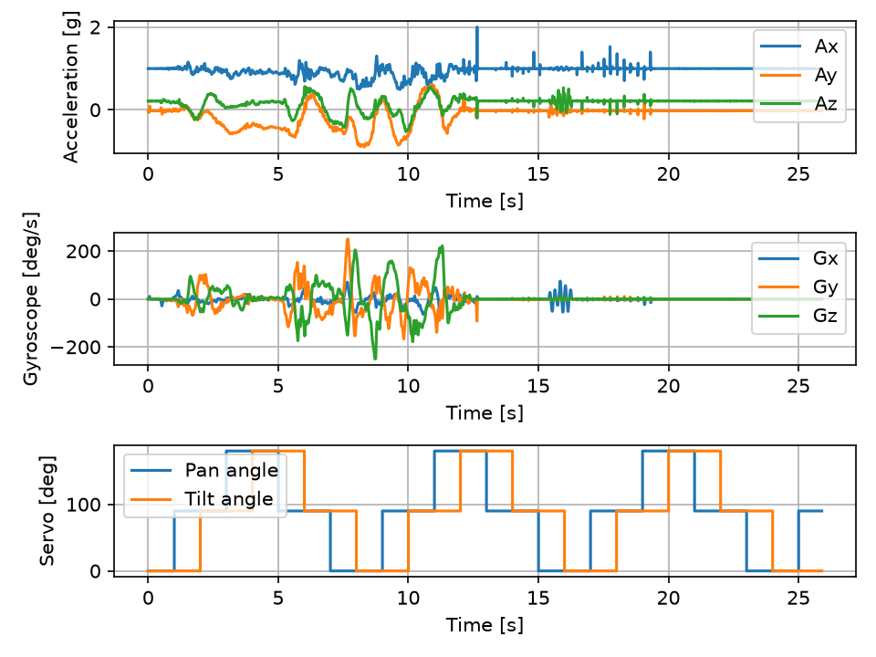

# Optomechanical Laser Alignment Testbench

Testbench built to see how well sensor feedback and mechanical spring preloading can fix the backlash and vibration issues of cheap SG90 micro-servos when steering a laser beam.

An ESP32 controls a 2-axis pan-tilt mount carrying a 650 nm laser diode (KY-008), while reading angle encoders, an IMU, and environmental sensors. A webcam on the PC tracks the laser spot on a target to close the control loop.

## Hardware notes

The pan-tilt bracket is 3D-printed and uses springs to preload the servo gears. Since SG90 servos draw current spikes that can reset or add noise to the ESP32, the servos and laser run on a separate 5V rail from an LM2596 buck converter. The laser is switched through an NPN transistor.

Sensors on the rig:
- 2x AS5600 magnetic encoders (12-bit) on the pan and tilt shafts to measure the real angle vs. commanded PWM.
- MPU-6050 IMU on the laser bracket to measure vibrations and impacts.
- BH1750 light sensor behind a pinhole on the target, plus a USB webcam running OpenCV to track the (X, Y) center of the laser dot.
- BMP280, AHT20, and INA219 to check if room temperature or laser current drift over time.
- SSD1306 OLED screen and a MicroSD SPI module for local display and logging.

## Todo / Progress

- [x] ESP-IDF I2C master driver (GPIO 21/22)
- [x] MPU-6050 communication check (WHO_AM_I returns 0x72 instead of 0x68 due to the clone chip on the GY-521 board)
- [x] Python serial reader and CSV logger (host/reader.py)
- [x] 14-byte burst read for accel, temp, and gyro
- [x] 100 Hz sampling loop + 44 Hz hardware low-pass filter (DLPF = 0x03)
- [x] Python script to plot acceleration and gyro data (host/imuplot.py)
- [x] PWM control for the SG90 servos (LEDC driver)
- [ ] GPIO switching for the laser transistor
- [ ] Read both AS5600 encoders
- [ ] Add BMP280, AHT20, INA219, and BH1750 drivers
- [ ] SSD1306 OLED and MicroSD SPI logging
- [ ] OpenCV script to find laser spot (X, Y) coordinates
- [ ] Closed-loop serial tracking

## I2C Addresses

All sensors use 3.3V logic. Both AS5600 encoders share the same fixed address (0x36), so they are split across the two hardware I2C buses of the ESP32:

| Component | Bus / Pins | Address | Notes |
| :--- | :--- | :--- | :--- |
| MPU-6050 | I2C0 (GPIO 21 / 22) | 0x68 | IMU on laser bracket (clone chip, WHO_AM_I = 0x72) |
| SSD1306 | I2C0 (GPIO 21 / 22) | 0x3C | OLED display |
| BMP280 | I2C0 (GPIO 21 / 22) | 0x76 | Temp / pressure |
| AHT20 | I2C0 (GPIO 21 / 22) | 0x38 | Humidity |
| BH1750 | I2C0 (GPIO 21 / 22) | 0x23 | Target light sensor |
| INA219 | I2C0 (GPIO 21 / 22) | 0x40 | Laser current / voltage |
| AS5600 (Pan) | I2C0 (GPIO 21 / 22) | 0x36 | Pan angle |
| AS5600 (Tilt)| I2C1 (GPIO 18 / 19) | 0x36 | Tilt angle |

Other pins (servo PWM, laser transistor, SPI) are listed in docs/wiring.md.

## 100 Hz IMU Test

The ESP32 reads the MPU-6050 at 100 Hz (10 ms loop) over I2C at 400 kHz. Because the raw readings were noisy without filtering, the internal 44 Hz low-pass filter is enabled (register 0x1A set to 0x03). Raw values are sent over serial, saved to data.csv, and converted to g (±2g scale -> 16384 LSB/g) and deg/s (±250 deg/s scale -> 131.072 LSB/(deg/s)).

Two SG90 servos (pan and tilt) are also driven by the ESP32, moving one at a time: every 1 s one of them steps to the next angle, so each servo changes position every 2 s. The angles plotted are the commanded ones, not measured.



Measured sampling rate is 100.0 Hz with 2591 samples in about 26 s, so no reads were lost. 
First ~12.5 s: tilting and rotating the breadboard by hand (the gyro reaches the ±250 deg/s limit around 7.7s and 8.7s). 
After that the board is left flat on the desk while the servos keep stepping. 
The spikes between 13s and 19.5s are from tapping the desk and breadboard. 
The sensor is not attached to the servos, so their movement doesn't show up in the data. 
Ax stays around 1g and Az around 0.2g at rest since the sensor module sits slightly crooked on the pins.

## How to run

Flash the ESP32 (ESP-IDF):
```bash
cd firmware
idf.py build
idf.py -p COM3 flash monitor
```

```bash
cd host
python -m venv .venv
.venv\Scripts\activate
pip install -r requirements.txt
python reader.py      # logs to data.csv (edit COM port inside)
python imuplot.py     # plots data.csv
```

## Prerequisites
Firmware Toolchain: ESP-IDF v5.x (installed via VS Code ESP-IDF Extension)
Host Environment: Python 3.10+ (pip install -r host/requirements.txt)

## Repository Structure

- `firmware/` – ESP-IDF C code and drivers
- `host/` – Python scripts for serial logging, plotting, and OpenCV
- `cad/` – 3D-printed mount parts and STEP files
- `docs/` – Pinouts and test plots