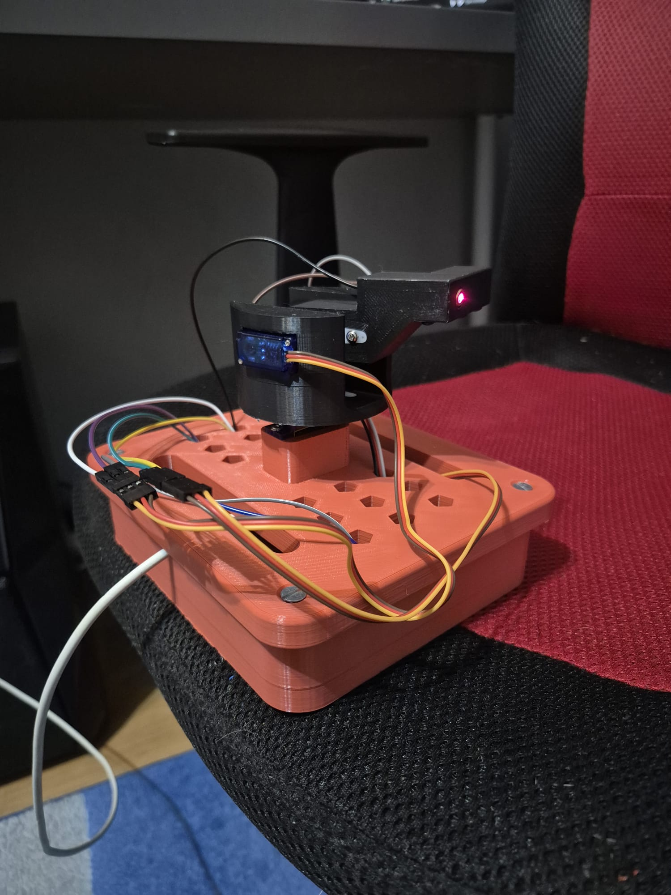
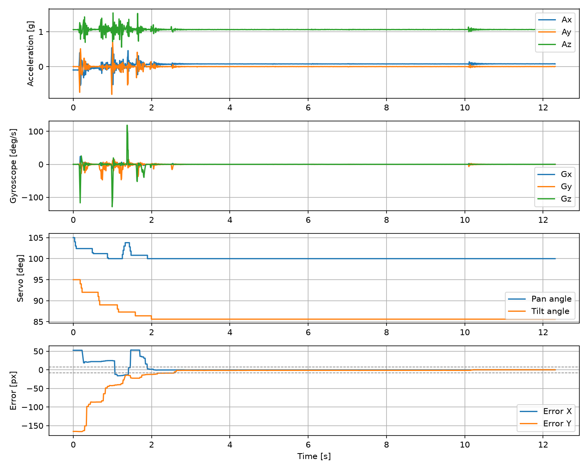

# Optomechanical Laser Alignment Testbench

Testbench built to see how well sensor feedback and mechanical spring preloading can fix the backlash and vibration issues of cheap SG90 micro-servos when steering a laser beam.

An ESP32 controls a 2-axis pan-tilt mount carrying a 650 nm laser diode (KY-008), while reading angle encoders, an IMU. A webcam on the PC tracks the laser spot on a target to close the control loop.

## Hardware notes

The pan-tilt bracket is 3D-printed and uses springs to preload the servo gears. Since SG90 servos draw current spikes that can reset or add noise to the ESP32, the servos and laser run on a separate 5V rail from an LM2596 buck converter. The laser is switched through an NPN transistor.

Sensors on the rig:
- MPU-6050 IMU on the laser bracket to measure vibrations and impacts.

## Physical Setup

<p align="center">
  
</p>

Current bench setup with the 3D-printed pan-tilt mount, SG90 servos, KY-008 laser diode, and the MPU-6050 mounted directly on the top tilt bracket. The ESP32 sits on the breadboard with the 100 nF decoupling capacitor on the 5V rail and the NPN transistor switch (1k base resistor, 10k pull-down) driving the laser on GPIO 27.

## Todo / Progress

- [x] ESP-IDF I2C master driver (GPIO 21/22)
- [x] MPU-6050 communication check (WHO_AM_I returns 0x72 instead of 0x68, since the GY-521 board has a clone chip)
- [x] Python serial reader and CSV logger (host/reader.py)
- [x] 14-byte burst read for accel, temp and gyro
- [x] 100 Hz sampling loop + 44 Hz hardware low-pass filter (DLPF = 0x03)
- [x] Python script to plot accel and gyro data (host/plot.py)
- [x] PWM control for the SG90 servos (LEDC driver)
- [x] Staggered servo movement, so the USB port doesn't brown out
- [x] Two-way UART: the ESP32 reads commands (CMD,pan,tilt) without blocking the main loop
- [ ] OpenCV script to find the laser spot (X, Y) coordinates
- [ ] Closed-loop serial tracking

## I2C Address

3.3V logic

| Component | Bus / Pins | Address | Notes |
| :--- | :--- | :--- | :--- |
| MPU-6050 | I2C0 (GPIO 21 / 22) | 0x68 | IMU on laser bracket (clone chip, WHO_AM_I = 0x72) |

Other pins (servo PWM, laser transistor, SPI) are listed in docs/wiring.md.

## IMU Data & UART Control Test

MPU-6050 at 100 Hz (sample rate divider 9, DLPF 44 Hz), +-2 g and +-250 deg/s. The IMU is mounted directly on the moving tilt bracket next to the laser, while sequential servo commands are sent from the PC over UART every 0.8 s.



- 0 - 1.0 s: mount at rest (pan 90, tilt 90), gravity on Z (~1 g), gyro flat at 0 deg/s
- 1.02 s: pan 90 -> 70 (sharp negative spike on Gz down to -250 deg/s, followed by mechanical ringing as the bracket settles)
- 1.82 s: tilt 90 -> 105 (positive spike on Gy up to +250 deg/s; Ax baseline shifts to ~ -0.28 g because the sensor is now tilted relative to gravity)
- 2.62 s: pan 70 -> 110 (positive Gz spike saturating at +250 deg/s with small cross-axis coupling on Gx)
- 3.42 s: tilt 105 -> 85 (negative Gy spike down to -250 deg/s; Ax baseline shifts slightly above 0 g for the 85 deg tilt angle)
- 4.22 s: pan 110 -> 90 (negative Gz spike down to -250 deg/s as pan returns to center)
- 5.02 s: tilt 85 -> 90 (positive Gy spike up to ~190 deg/s; Ax returns to 0 g)
- 5.3 - 6.0 s: back at rest at (90, 90), vibrations damp out completely

Servos are moved one axis at a time with a 0.8 s delay between steps to avoid overlapping stall currents on the 5V USB rail and to isolate pan (Gz) and tilt (Gy) dynamics on the IMU plots.

## How to run

Flash the ESP32 (ESP-IDF):
```bash
cd firmware
idf.py build
idf.py -p COM3 flash monitor
```

```bash
cd host
python -m venv .venv
.venv\Scripts\activate
pip install -r requirements.txt
python reader.py      # logs to data.csv (edit COM port inside)
python imuplot.py     # plots data.csv
```

## Prerequisites
Firmware Toolchain: ESP-IDF v5.x (installed via VS Code ESP-IDF Extension)
Host Environment: Python 3.10+ (pip install -r host/requirements.txt)

## Repository Structure

- `firmware/` – ESP-IDF C code and drivers
- `host/` – Python scripts for serial logging, plotting, and OpenCV
- `cad/` – 3D-printed mount parts and STEP files
- `docs/` – Pinouts and test plots